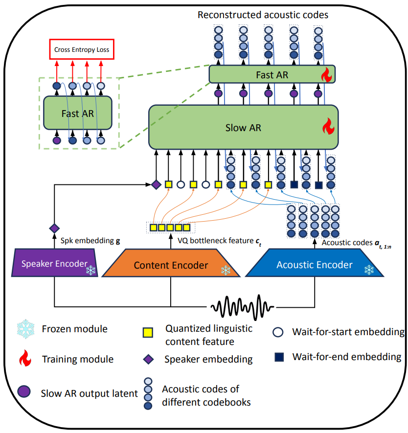
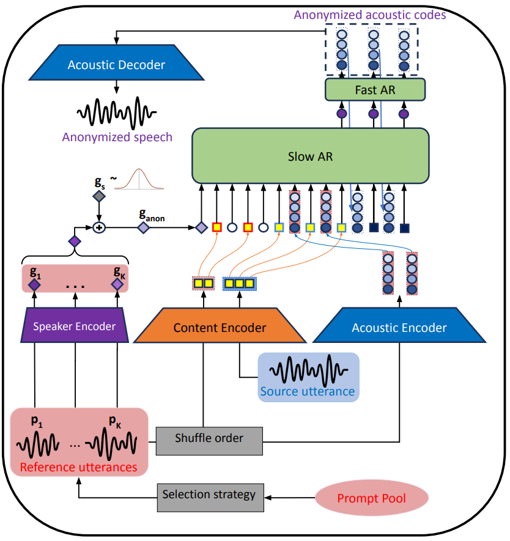

<h1 align="center">Stream-Voice-Anon: Enhancing Utility of Real-Time Speaker Anonymization via Neural Audio Codec and Language Models</h1>

<p align="center">
  
  <a href="https://paniquex.github.io/Stream-Voice-Anon/"></a>
  <a href="https://arxiv.org/abs/2601.13948"></a>
  <a href="https://huggingface.co/Plachta/StreamVoiceAnon"></a>
  
</p>


<div align="center">
  <b>Nikita Kuzmin<sup>1,2*</sup>, Songting Liu<sup>1*</sup>, Kong Aik Lee<sup>3</sup>, Eng Siong Chng<sup>1</sup></b>
  <br>
  <sup>1</sup><a href="https://www.ntu.edu.sg/">Nanyang Technological University</a>, Singapore
  <br>
  <sup>2</sup><a href="https://www.a-star.edu.sg/i2r">Institute for Infocomm Research, A*STAR</a>, Singapore
  <br>
  <sup>3</sup><a href="https://www.polyu.edu.hk/">The Hong Kong Polytechnic University</a>, Hong Kong
  <br>
  <i>* Equal contribution</i>
  <h4>ICASSP 2026</h4>
</div>

> [!IMPORTANT]
> **📣 Our extension, StreamVoiceAnon+, has been accepted to Interspeech 2026!**
> Expand the section just below for the paper, authors, and approach.

<details>
<summary><b>StreamVoiceAnon+: paper, authors &amp; details (click to expand)</b></summary>

<br>

<h3 align="center">StreamVoiceAnon+: Emotion-Preserving Streaming Speaker Anonymization via Frame-Level Acoustic Distillation</h3>

<p align="center">
  <a href="https://paniquex.github.io/streamvoiceanon-plus/"></a>
  <a href="https://paniquex.github.io/streamvoiceanon-plus/"></a>
  <a href="https://arxiv.org/abs/2603.06079"></a>
  
</p>

<div align="center">
  <b>Nikita Kuzmin<sup>1,2</sup>, Kong Aik Lee<sup>3</sup>, Eng Siong Chng<sup>1</sup></b>
  <br>
  <sup>1</sup><a href="https://www.ntu.edu.sg/">Nanyang Technological University</a>, Singapore
  <br>
  <sup>2</sup><a href="https://www.a-star.edu.sg/i2r">Institute for Infocomm Research, A*STAR</a>, Singapore
  <br>
  <sup>3</sup><a href="https://www.polyu.edu.hk/">The Hong Kong Polytechnic University</a>, Hong Kong
  <h4>Interspeech 2026</h4>
</div>

StreamVoiceAnon+ extends StreamVoiceAnon to keep the speaker's *emotion* through anonymization, not just the spoken content. You can find more details in our [paper](https://arxiv.org/abs/2603.06079).

<p align="center">
  
  <br>
  <em>Training / inference pipeline for StreamVoiceAnon+.</em>
</p>

</details>

## Architecture
This repository contains the implementation of StreamVoiceAnon, a real-time voice anonymization / voice conversion model.

<table align="center">
  <tr>
    <td align="center">
      
      <br>
      <em>(a) Training</em>
    </td>
    <td align="center">
      
      <br>
      <em>(b) Inference</em>
    </td>
  </tr>
</table>

## Installation
```bash
git clone https://github.com/Plachtaa/StreamVoiceAnon.git
cd StreamVoiceAnon
pip install -r requirements.txt
```

If running on Windows OS, please install the following:
```bash
pip install triton-windows==3.2.0.post13
```
Note that this is **compulsory** to run inference with RTF < 1.0

Full MacOS support is still under construction.

## Download Pretrained Models
```bash
hf download Plachta/StreamVoiceAnon --local-dir pretrained_checkpoints/
```

## Training
Below is an example command to launch single node multi-GPU training with streaming Emilia dataset from HuggingFace:
```bash
accelerate launch trainers/arvc_trainer.py --config_path configs/config_firefly_arvcasr_8192_delay0_8.yaml --mixed-precision bf16
```

Above command uses default content encoder and trains only the VC model. To train your own content encoder, 
run the following command instead:
```bash
accelerate launch trainers/asr_trainer.py --config_path configs/config_asr_bsq_8192.yaml --mixed-precision bf16
```
To customize model config or training datasets, we encourage users to read config files or training code.


## Inference
Offline inference 
```bash
python evaluations/infer_arvc.py \
    --src_path <path_to_audio> \
    --ref_path <path_to_audio> \
    --out_dir <path_to_output_directory> \
    --delay 2 \  # Specify delay in number of frames (must have)
    --compile
```
Simulated online inference
```bash
python evaluations/infer_arvc.py \
    --src_path <path_to_audio> \
    --ref_path <path_to_audio> \
    --out_dir <path_to_output_directory> \
    --delay 2 \  # Specify delay in number of frames (must have)
    --compile \
    --simulate_streaming \
    --decode_chunk_frames 1 # how many frames for encoder & vocoder to process each time
```
This simulates a chunk-by-chunk online inference with specified chunk size. `src_path` (source audio) has no length limit here. `ref_path` (reference audio) will be truncated to some maximum length (if longer than that limit)

### Anonymization with noise mixing
Use the `--alpha` flag to control the noise mixing ratio on speaker embeddings. A value of `1.0` means no noise (pure voice conversion), while lower values blend more noise into the speaker representation for stronger anonymization.
```bash
python evaluations/infer_arvc.py \
    --src_path <path_to_source_audio> \
    --ref_path <path_to_reference_audio> \
    --out_dir <path_to_output_directory> \
    --delay 2 \
    --alpha 0.8 \
    --compile
```

### Multiple reference audios
Provide multiple `--ref_path` entries to derive a combined speaker representation from several reference utterances. Using multiple references further improves privacy protection, making it harder to trace back to real speaker and better distorting the source's original speaker characteristics. You can optionally crop each reference to a specific duration (in seconds) with `--ref_crop_lengths`.
```bash
python evaluations/infer_arvc.py \
    --src_path <path_to_source_audio> \
    --ref_path <path_to_ref1> <path_to_ref2> <path_to_ref3> \
    --ref_crop_lengths 5.0 3.0 4.0 \
    --out_dir <path_to_output_directory> \
    --delay 2 \
    --compile
```

### Combined: multiple references with noise anonymization
```bash
python evaluations/infer_arvc.py \
    --src_path <path_to_source_audio> \
    --ref_path <path_to_ref1> <path_to_ref2> \
    --ref_crop_lengths 5.0 5.0 \
    --out_dir <path_to_output_directory> \
    --delay 2 \
    --alpha 0.7 \
    --compile
```

Real-time inference
```bash
python evaluations/real-time-gui.py
```
This UI uses the same behavior as simulated online inference. It uses `--compile` by default, so please ensure you have installed triton (as previously stated) before using it.

## Citation
If you find our repository valuable for your work, please consider giving a star to this repo and citing the relevant papers:

**StreamVoiceAnon (ICASSP 2026)**
```
@misc{kuzmin2026streamvoiceanonenhancingutilityrealtime,
      title={Stream-Voice-Anon: Enhancing Utility of Real-Time Speaker Anonymization via Neural Audio Codec and Language Models}, 
      author={Nikita Kuzmin and Songting Liu and Kong Aik Lee and Eng Siong Chng},
      year={2026},
      eprint={2601.13948},
      archivePrefix={arXiv},
      primaryClass={eess.AS},
      url={https://arxiv.org/abs/2601.13948}, 
}
```

**StreamVoiceAnon+ (Interspeech 2026)**
```
@misc{kuzmin2026streamvoiceanonemotionpreservingstreamingspeaker,
      title={StreamVoiceAnon+: Emotion-Preserving Streaming Speaker Anonymization via Frame-Level Acoustic Distillation}, 
      author={Nikita Kuzmin and Kong Aik Lee and Eng Siong Chng},
      year={2026},
      eprint={2603.06079},
      archivePrefix={arXiv},
      primaryClass={eess.AS},
      url={https://arxiv.org/abs/2603.06079}, 
}
```
## Acknowledgements
 - Emotion representations: https://huggingface.co/emotion2vec/emotion2vec_plus_large
 - Computation resources: https://www.nscc.sg/
 - Real-time GUI: https://github.com/RVC-Project/Retrieval-based-Voice-Conversion-WebUI
 - Speaker representations (1 of 2) https://huggingface.co/funasr/campplus
 - Speaker representations (2 of 2) https://github.com/SparkAudio/Spark-TTS
 - Speech acoustic codec https://huggingface.co/fishaudio/fish-speech-1.5
 - Idea: https://arxiv.org/html/2401.11053v1
 - VoicePrivacyChallenge: https://www.voiceprivacychallenge.org/
