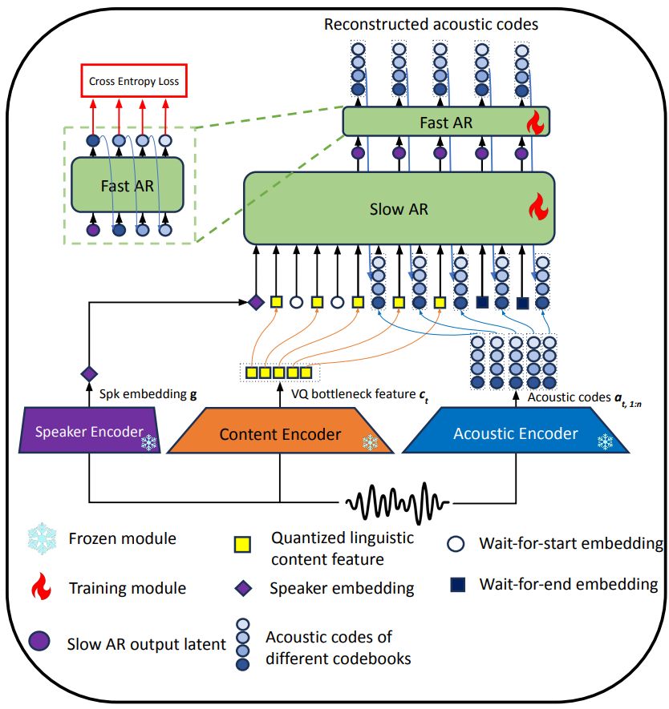
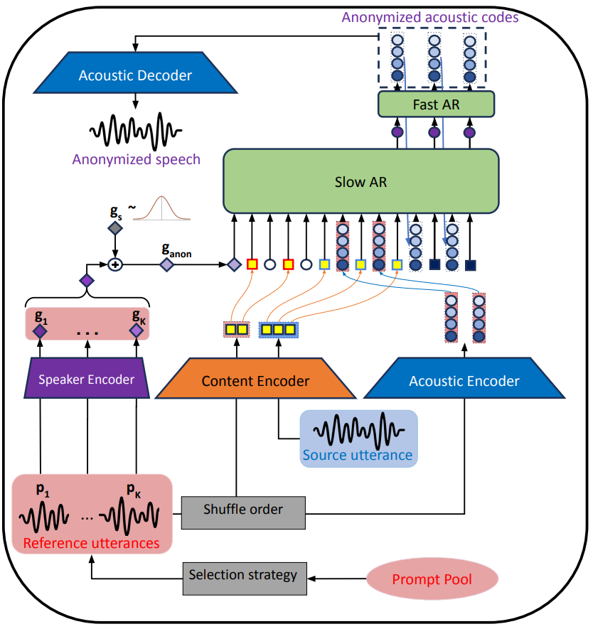
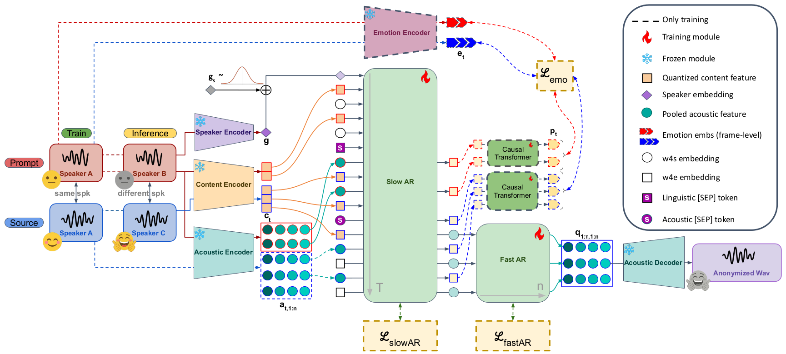

<h1 align="center">StreamVoiceAnon</h1>

<p align="center">Streaming speaker anonymization with neural audio codecs and autoregressive voice conversion</p>

<p align="center">
  
  <a href="https://paniquex.github.io/Stream-Voice-Anon/"></a>
  <a href="https://arxiv.org/abs/2601.13948"></a>
  <a href="https://huggingface.co/Plachta/StreamVoiceAnon"></a>
</p>

<p align="center">
  
  <a href="https://arxiv.org/abs/2603.06079"></a>
  <a href="https://huggingface.co/paniquex/StreamVoiceAnonPlus"></a>
</p>

## Contents

- [Models](#models)
- [Architecture](#architecture)
- [Installation](#installation) · [Linux](#linux) · [Windows with CUDA](#windows-with-cuda)
- [Download pretrained models](#download-pretrained-models)
- [Inference](#inference) · [Python API](#python)
- [StreamVoiceAnon training](#streamvoiceanon-training)
- [Results on development and test](#results-on-development-and-test)
- [Citation](#citation) · [License and acknowledgements](#license-and-acknowledgements)

## Models

StreamVoiceAnon uses a reference utterance to condition streaming voice conversion for speaker anonymization. StreamVoiceAnon+ adds two checkpoints fine-tuned to preserve emotion in the source utterance.

| Model | CLI option | Code release | Weights |
| --- | --- | --- | --- |
| StreamVoiceAnon | `--model base` | [v0.1.0](https://github.com/Plachtaa/StreamVoiceAnon/releases/tag/v0.1.0) | [Baseline checkpoint](https://huggingface.co/Plachta/StreamVoiceAnon/blob/3684dff8e8706b306e6d1f0217a1f79968bbb966/dual_ar_delay_0_8.pth) |
| StreamVoiceAnon+ frame-distill | `--model frame-distill` | [v0.2.0](https://github.com/Plachtaa/StreamVoiceAnon/releases/tag/v0.2.0) | [frame-distill checkpoint](https://huggingface.co/paniquex/StreamVoiceAnonPlus/blob/v0.2.0-hub/frame.pth) |
| StreamVoiceAnon+ pool-distill | `--model pool-distill` | [v0.2.0](https://github.com/Plachtaa/StreamVoiceAnon/releases/tag/v0.2.0) | [pool-distill checkpoint](https://huggingface.co/paniquex/StreamVoiceAnonPlus/blob/v0.2.0-hub/pool.pth) |

`frame-distill` is the default. The [original StreamVoiceAnon release](https://github.com/Plachtaa/StreamVoiceAnon/releases/tag/v0.1.0) includes the GUI and examples.

## Architecture

### StreamVoiceAnon

A causal content encoder supplies content tokens to a two-stage autoregressive voice conversion (ARVC) model. Slow AR runs at the frame rate, and Fast AR predicts the acoustic codebook tokens within each frame. The acoustic decoder turns those tokens into a waveform.

<p align="center">
  <a href="figures/streamvoiceanon_training_cropped.png"></a>
  <a href="figures/streamvoiceanon_inference_cropped.png"></a>
  <br>
  <em>(a) Training · (b) Streaming inference</em>
</p>

### StreamVoiceAnon+ training and inference

<p align="center">
  <a href="figures/streamvoiceanonplus_architecture.png"></a>
</p>

In both Plus variants, learned `[SEP]` tokens separate the reference prompt from the source utterance in the semantic and acoustic token streams. During fine-tuning, `frame-distill` uses frame-level emotion distillation on the Slow AR acoustic-token hidden states. `pool-distill` uses statistical pooling for utterance-level emotion classification. The auxiliary emotion heads are used during fine-tuning. Both variants use the same streaming decoder at inference. [StreamVoiceAnon+ paper, Figure 2](https://arxiv.org/html/2603.06079v1#S1.F2)

## Installation

### Linux

Run these commands from the repository root on Linux with Python 3.10 and a CUDA-capable GPU. This installs the CUDA 12.4 build of PyTorch.

On Ubuntu 22.04, install the system packages first. The compiler and Python development headers are required by the `--compile` examples.

```bash
sudo apt-get update
sudo apt-get install -y python3.10-venv python3.10-dev build-essential ffmpeg libsndfile1 libgomp1
```

```bash
python3.10 -m venv .venv
source .venv/bin/activate
python -m pip install torch==2.4.0 torchvision==0.19.0 torchaudio==2.4.0 --index-url https://download.pytorch.org/whl/cu124
python -m pip install -r environment/requirements-inference.txt
python -m pip install --no-deps .
```

The [container recipe](environment/Dockerfile) uses the same dependencies.

### Windows with CUDA

Use 64-bit Python 3.10, an NVIDIA Ampere or Ada GPU, and a current NVIDIA driver. Install the x64 Visual C++ Redistributable. The Windows setup uses PyTorch 2.6 with the same Windows Triton pin used by the original StreamVoiceAnon release. [Microsoft redistributable](https://learn.microsoft.com/en-us/cpp/windows/latest-supported-vc-redist) · [Triton compatibility](https://github.com/triton-lang/triton-windows/blob/readme/README.md#3-pytorch)

Run these commands in PowerShell from the repository root.

```powershell
py -3.10 -m venv .venv
$python = ".\.venv\Scripts\python.exe"
$hf = ".\.venv\Scripts\hf.exe"
& $python -m pip install torch==2.6.0 torchvision==0.21.0 torchaudio==2.6.0 --index-url https://download.pytorch.org/whl/cu124
& $python -m pip install -r environment/requirements-inference.txt triton-windows==3.2.0.post13
& $python -m pip install --no-deps .
& $python -c "import torch, triton; assert torch.cuda.is_available(); print(torch.cuda.get_device_name(), torch.version.cuda, triton.__version__)"
```

Download the baseline checkpoint, shared components, and both Plus checkpoints.

```powershell
& $hf download Plachta/StreamVoiceAnon --revision 3684dff8e8706b306e6d1f0217a1f79968bbb966 --local-dir pretrained_checkpoints
& $hf download paniquex/StreamVoiceAnonPlus config.json frame.pth frame.receipt.json pool.pth pool.receipt.json --revision v0.2.0-hub --local-dir pretrained_checkpoints
```

Run optimized file inference with `--compile`. The cache setting works around a PyTorch 2.6 issue on Windows. The first run compiles CUDA kernels and can take a few minutes.

```powershell
$env:TORCHINDUCTOR_BUNDLE_TRITON_INTO_FX_GRAPH_CACHE = "0"
& $python evaluations/infer_arvc.py --model frame-distill --checkpoint_path pretrained_checkpoints/frame.pth --src_path source.wav --ref_path reference.wav --out_dir audio_outputs --delay 2 --compile --simulate_streaming --decode_chunk_frames 3
```

Use `--model pool-distill --checkpoint_path pretrained_checkpoints/pool.pth` for pool-distill or `--model base --checkpoint_path pretrained_checkpoints/dual_ar_delay_0_8.pth` for StreamVoiceAnon. Omit `--compile` to run without compilation. GPU release checks were run on Linux. Native Windows inference and throughput still need a Windows GPU test. On WSL 2, check `nvidia-smi` inside Ubuntu 22.04 and follow the Linux setup. [CUDA on WSL 2](https://learn.microsoft.com/en-us/windows/ai/directml/gpu-cuda-in-wsl)

## Download pretrained models

Download the StreamVoiceAnon checkpoint and the four components shared by all three models. [StreamVoiceAnon weights](https://huggingface.co/Plachta/StreamVoiceAnon)

```bash
hf download Plachta/StreamVoiceAnon \
    --revision 3684dff8e8706b306e6d1f0217a1f79968bbb966 \
    --local-dir pretrained_checkpoints
```

For `frame-distill`, download the release configuration, checkpoint, and checksum receipt into the same directory. [StreamVoiceAnon+ weights](https://huggingface.co/paniquex/StreamVoiceAnonPlus)

```bash
hf download paniquex/StreamVoiceAnonPlus config.json frame.pth frame.receipt.json \
    --revision v0.2.0-hub \
    --local-dir pretrained_checkpoints
```

For `pool-distill`, use the same `config.json` and substitute `pool.pth` and `pool.receipt.json`. Keep each checkpoint and its receipt together. See the [shared component hashes](src/streamvoiceanonplus/resources/components.json) and [Plus checkpoint hashes](https://huggingface.co/paniquex/StreamVoiceAnonPlus/blob/v0.2.0-hub/inference-manifest.json).

## Inference

Use `source.wav` for the speech to anonymize and `reference.wav` for the target speaker prompt.

### StreamVoiceAnon

```bash
python evaluations/infer_arvc.py \
    --model base --checkpoint_path pretrained_checkpoints/dual_ar_delay_0_8.pth \
    --src_path source.wav --ref_path reference.wav --out_dir audio_outputs \
    --delay 2 --compile
```

### StreamVoiceAnon+ frame-distill

```bash
python evaluations/infer_arvc.py \
    --model frame-distill --checkpoint_path pretrained_checkpoints/frame.pth \
    --src_path source.wav --ref_path reference.wav --out_dir audio_outputs \
    --delay 2 --compile --simulate_streaming --decode_chunk_frames 3
```

Select `pool-distill` with `--model pool-distill --checkpoint_path pretrained_checkpoints/pool.pth`. With `--simulate_streaming`, the script processes the file in chunks. Omit the flag for offline inference. For these examples, the script writes `audio_outputs/source_reference.wav` at 44.1 kHz.

The evaluation used a two-frame decoding delay and three-frame chunks. Both model families use speaker embedding mixing at inference. `--alpha 0.9` sets the weight of each reference speaker embedding in its mixture with Gaussian noise. The code calls the two embeddings style and timbre.

StreamVoiceAnon accepts multiple reference utterances and optional crop lengths via `--ref_crop_lengths`. Each Plus variant takes one reference utterance. Use `--config_path` to reuse component paths from a StreamVoiceAnon YAML file, or `--components` to select a shared checkpoint directory. Run `sva infer --help` for seeded inference with 16 kHz output.

### Python

```python
from streamvoiceanonplus import InferenceWrapper

with InferenceWrapper(
    checkpoint_path="pretrained_checkpoints/frame.pth",
    model="frame-distill",
    compile_ar=True,
) as model:
    audio = model.stream_infer("source.wav", "reference.wav", "audio_outputs")
```

The same class is available from `evaluations.infer_arvc` for code using the original script path.

## StreamVoiceAnon training

The source release includes the original StreamVoiceAnon trainers for voice conversion and the content encoder, along with their configurations and data loader. The Plus release provides inference weights. [Training guide](training/streamvoiceanon/README.md)

## Results on development and test

| Model | WER ↓ | UAR ↑ | EER-L ↑ |
| --- | ---: | ---: | ---: |
| StreamVoiceAnon | 4.55 | 39.84 | 46.91 |
| StreamVoiceAnon+ frame-distill | 6.00 | 51.22 | 47.26 |
| StreamVoiceAnon+ pool-distill | 5.47 | 48.32 | 46.10 |

The table reports word error rate (WER) on LibriSpeech, unweighted average recall (UAR) for speech emotion recognition on IEMOCAP, and equal error rate against a lazy-informed attacker (EER-L). The attacker uses an automatic speaker verification model trained on original speech and scores anonymized enrollment and trials.

All scores are percentages. WER and UAR give the full development and test splits equal weight. EER-L is the mean of the four split-by-gender scores. Checkpoint selection used development data.

The release scores differ slightly from those reported in the [StreamVoiceAnon+ paper](https://arxiv.org/abs/2603.06079), reflecting differences in the training environment and minor changes to the inference settings. We reran fine-tuning from pretrained StreamVoiceAnon on a different compute cluster with its own GPU configuration and training runtime.

The bundled VoicePrivacy adapter covers the development split. It uses the [pinned external evaluator](https://github.com/Plachtaa/StreamVoiceAnon/tree/dd637252146ce8e3c0882f15672a14c393199931/anon) and its own dependencies. Run `python -m streamvoiceanonplus.vpc_adapter --help` for checkout verification and configuration.

## Citation

- [Stream-Voice-Anon: Enhancing Utility of Real-Time Speaker Anonymization via Neural Audio Codec and Language Models](https://arxiv.org/abs/2601.13948) (ICASSP 2026)
- [StreamVoiceAnon+: Emotion-Preserving Streaming Speaker Anonymization via Frame-Level Acoustic Distillation](https://arxiv.org/abs/2603.06079) (Interspeech 2026)

[BibTeX](CITATION.bib)

## License and acknowledgements

The inference code is [MIT-licensed](LICENSE). The original StreamVoiceAnon training code uses [Apache 2.0](training/streamvoiceanon/LICENSE). See [NOTICE](NOTICE) for third-party code. Model weights and datasets have separate terms.

The models use [CAMPPlus](https://huggingface.co/funasr/campplus), [Spark-TTS](https://github.com/SparkAudio/Spark-TTS), and [Fish-Speech](https://huggingface.co/fishaudio/fish-speech-1.5). Evaluation uses the [VoicePrivacy 2024](https://arxiv.org/abs/2404.02677) datasets and metrics.
